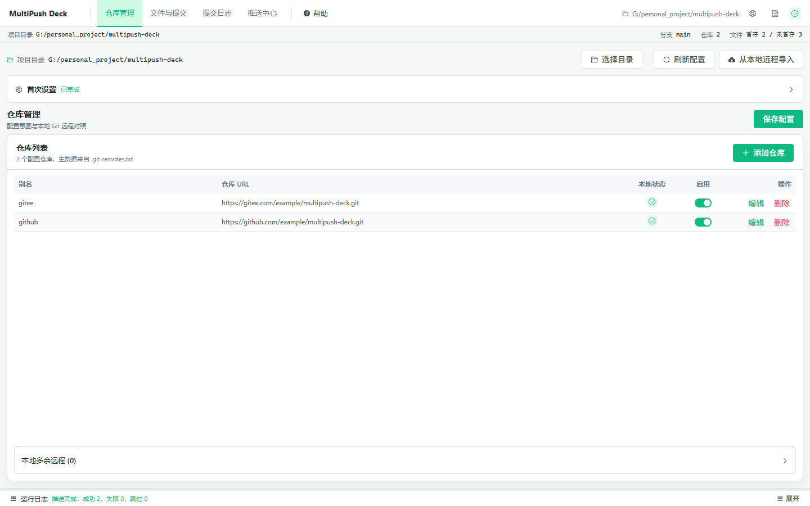
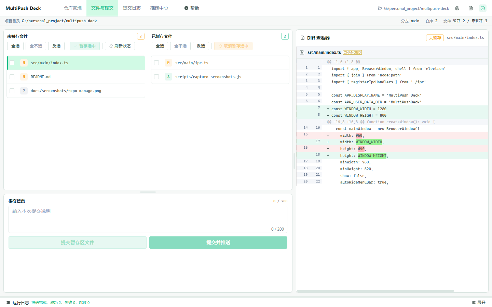
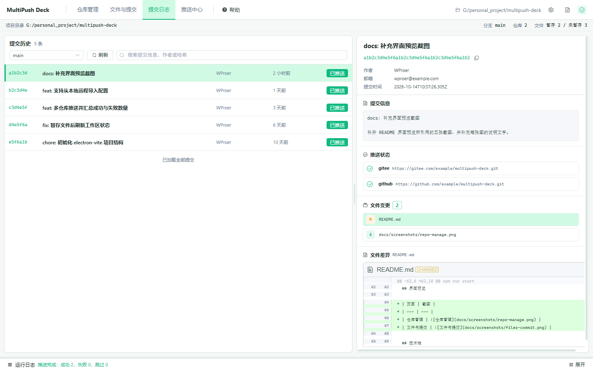
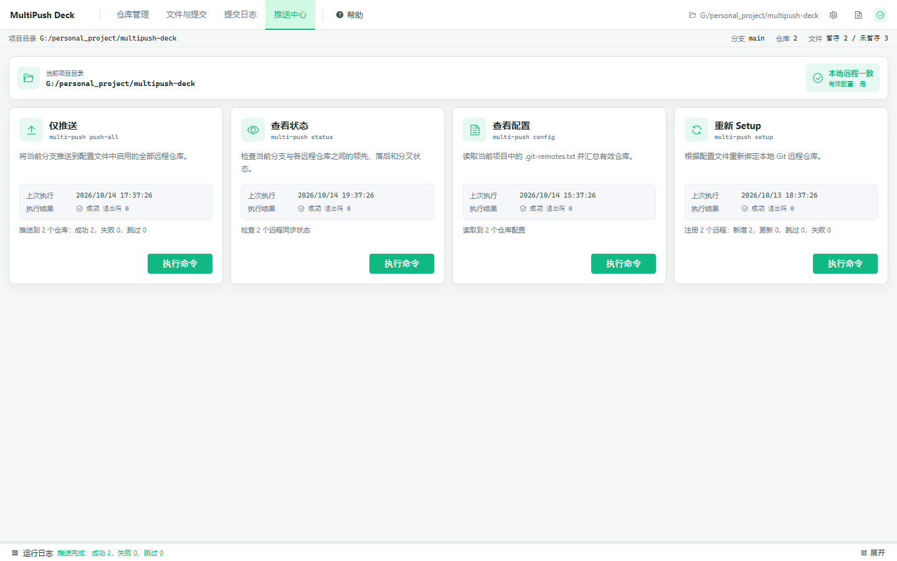
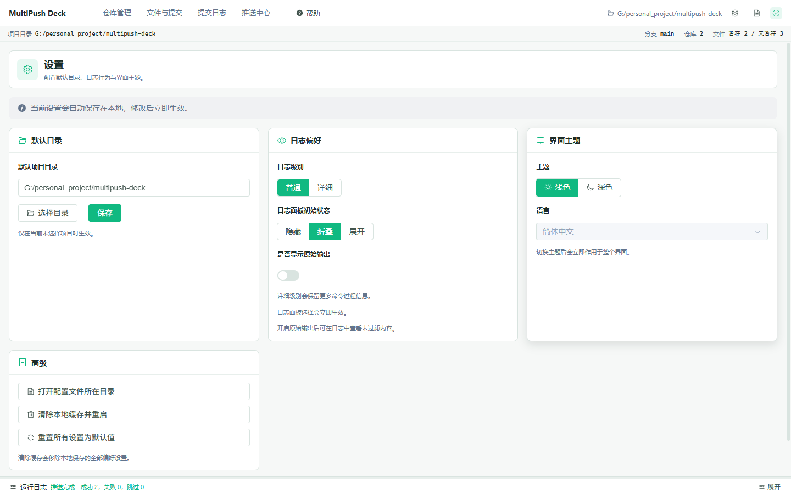

# MultiPush Deck


## 简介

MultiPush Deck 是一款跨平台的桌面客户端，用于把同一份代码推送到多个远程 Git 仓库。它把配置管理、远程 Setup、文件暂存、提交和多仓库推送集中到一个界面中，减少反复执行 `git remote` 与 `git push` 的成本。

核心理念是“一份代码，多端同步”。所有 Git 操作都基于系统已安装的 Git，通过子进程执行，应用本身不引入额外的 Git 运行时。

当前版本：v1.0.0。

## 下载安装

### 直接下载（推荐）

前往 Releases 页面下载最新版安装包：

[下载 MultiPush Deck v1.0.0](https://github.com/WProer/multipush-deck/releases/latest)

| 平台 | 安装包 |
| --- | --- |
| Windows | MultiPush Deck-1.0.0-Setup.exe |
| macOS | 暂未提供 |
| Linux | 暂未提供 |

当前已发布的安装包平台以 Releases 页面为准。

### 首次运行提示

Windows 首次运行可能弹出 SmartScreen 提示，因为当前安装包未购买代码签名证书。点击“更多信息”，再点击“仍要运行”即可继续。

### 从源码构建

环境要求：

- Node.js >= 20
- npm >= 9 或 pnpm >= 8
- 系统已安装 Git，用于实际的暂存、提交、远程管理与推送操作

```bash
# 克隆仓库
git clone https://github.com/WProer/multipush-deck.git
cd multipush-deck

# 安装依赖
npm install

# 启动开发模式
npm run dev
```

构建应用：

```bash
# 类型检查并构建
npm run build

# 预览构建结果
npm run start
```

## 功能特性

| 功能 | 说明 |
| --- | --- |
| 多仓库管理 | 在图形界面中配置 Gitee、GitHub、GitLab 以及自建 Git 服务的仓库地址，支持别名、编辑和删除。 |
| 一键多推 | 单次操作推送到全部已启用仓库。单个仓库失败不会阻断其它仓库，并汇总成功、失败与跳过数量。 |
| 选择性提交 | 未暂存文件与已暂存文件分区展示，支持逐文件暂存、取消暂存、全选、全不选和反选。 |
| 文件级操作 | 支持双击暂存或取消暂存、右键菜单操作，以及在 Diff 查看器中查看文件差异。 |
| 提交日志 | 查看当前分支的历史提交，并对照各个远程仓库判断提交是否已推送。 |
| 本地远程导入 | 从本地 `git remote -v` 读取已有远程，反向导入到 `.git-remotes.txt` 配置文件。 |
| 配置一致性检查 | 实时对照配置文件与本地 Git 远程，提示配置文件是否存在、有效仓库数量以及本地远程是否一致。 |
| 全局日志面板 | 所有命令输出以卡片形式记录，支持折叠、搜索、仅显示失败，并支持复制全部日志内容用于外部保存。 |
| 深色与浅色主题 | 在设置页切换浅色或深色主题，切换后立即作用于整个界面。 |

## 界面预览

> 截图待补充。请将界面截图放入 `docs/screenshots/` 目录，文件名与下表保持一致。

| 页面 | 截图 |
| --- | --- |
| 仓库管理 |  |
| 文件与提交 |  |
| 提交日志 |  |
| 推送中心 |  |
| 设置 |  |

## 技术栈

下表版本以 `package-lock.json` 的锁定结果为准。

| 类别 | 技术 | 版本 |
| --- | --- | --- |
| 桌面框架 | Electron | 38.8.6 |
| 前端框架 | Vue 3 | 3.5.43 |
| UI 组件库 | Element Plus | 2.14.7 |
| 状态管理 | Pinia | 3.0.4 |
| 路由 | Vue Router | 4.6.4 |
| Diff 渲染 | diff2html | 3.4.56 |
| 可拖动面板 | splitpanes | 4.1.2 |
| 构建工具 | electron-vite | 4.0.1 |
| 语言 | TypeScript | 5.9.3 |
| Git 调用 | 系统 Git（通过子进程） | 2.x |

## 环境要求

- Node.js >= 20
- npm >= 9 或 pnpm >= 8
- 系统已安装 Git，用于实际的暂存、提交、远程管理与推送操作

## 快速开始

1. 启动应用后，在顶部菜单栏选择需要管理的 Git 项目目录。
2. 进入“仓库管理”页，添加或编辑远程仓库地址。仓库地址支持 Gitee、GitHub、GitLab 以及自建 Git 服务。
3. 点击“初始化配置”，在项目根目录生成 `.git-remotes.txt`。如果本地已经存在 Git 远程，可以点击“从本地远程导入”把已有远程写入配置文件。
4. 点击“Setup 远程”，把配置文件中启用的仓库写入本地 Git 的 remote 列表。
5. 进入“文件与提交”页，勾选并暂存需要提交的文件，填写提交信息后提交。
6. 点击“提交并推送”，或者切换到“推送中心”点击“仅推送”，把提交推送到全部已启用仓库。
7. 在“提交日志”页查看历史提交，以及每个远程仓库的推送状态。

## 日常使用流程

- 在“文件与提交”页查看未暂存文件和已暂存文件。
- 勾选文件后点击“暂存选中”，或者双击文件执行暂存。
- 在提交面板填写提交信息，点击“提交暂存区文件”。
- 点击“提交并推送”，或到“推送中心”点击“仅推送”。
- 在“提交日志”页确认提交是否已经推送到所有配置的远程。
- 如果配置文件与本地远程不一致，回到“仓库管理”页执行“刷新配置”或“Setup 远程”。

## 配置文件格式

默认配置文件名为 `.git-remotes.txt`，位于当前项目目录的根目录。支持的写法如下：

```text
# Git 多仓库同步配置文件
# 注释以 # 开头，空行会被忽略

[gitee] https://gitee.com/username/repo.git
[github] https://github.com/username/repo.git
https://gitlab.com/group/project.git
```

说明：

- 注释行和空行会被忽略，示例占位地址不会被当作有效仓库。
- 仓库行支持 `URL`、`别名 URL` 和 `[别名] URL` 三种形式。
- Setup 只处理配置文件中处于启用状态的仓库。
- 从本地远程导入时，别名冲突且 URL 不同的项目默认跳过，确认后才使用本地 URL 覆盖配置。

## 项目结构

```text
src/
  main/        Electron 主进程、Git 命令封装、IPC 处理与多仓库推送核心
  preload/     preload API，向渲染进程暴露受控的 IPC 方法
  renderer/    Vue 3 渲染进程，包含页面、组件、路由、Pinia store 与样式
  shared/      主进程与渲染进程共享的类型、IPC 通道和配置解析逻辑
docs/
  screenshots/ 界面截图目录（截图待补充）
```

## 常用脚本

| 命令 | 说明 |
| --- | --- |
| `npm run dev` | 以开发模式启动 Electron 应用。 |
| `npm run build` | 先执行 TypeScript 类型检查，再通过 electron-vite 构建。 |
| `npm run start` | 预览已经构建的应用。 |
| `npm run typecheck` | 同时执行主进程和渲染进程的类型检查。 |
| `npm run typecheck:node` | 只检查主进程与 shared 类型。 |
| `npm run typecheck:web` | 只检查渲染进程类型。 |

## 构建与打包

```bash
# 打包 Windows 安装包（如果 package.json 里已配置 build:win）
npm run build:win

# 或者手动执行
npm run build
npx electron-builder --win
```

打包配置位于 `package.json` 的 `build` 字段，当前包含以下目标：

- Windows：NSIS 安装包
- macOS：DMG 镜像
- Linux：AppImage

安装包默认输出到 `dist/` 目录。当前已发布版本仅提供 Windows 安装包，macOS 与 Linux 安装包暂未提供。

## 常见问题

### 本地已经有远程仓库，但配置文件为空怎么办？

进入“仓库管理”页，点击“从本地远程导入”。应用会读取本地 `git remote -v`，把尚未写入配置文件的远程合并进去。

### 配置文件与本地 Git 远程不一致怎么办？

先检查“仓库管理”页顶部的配置状态提示。可以执行“刷新配置”查看差异；确认配置文件内容后，点击“Setup 远程”把配置写入本地 Git。如果本地远程更多，也可以使用“从本地远程导入”反向同步配置。

### 推送失败怎么办？

打开底部全局日志面板查看失败仓库的具体输出。常见原因包括网络不可达、认证过期、远程地址错误或分支不存在。修正后可以在“推送中心”重新执行“仅推送”。

### 如何只推送到其中一个仓库？

当前“仅推送”面向全部已启用仓库。如果需要临时只推送某一个仓库，可以在系统终端对该仓库执行 `git push`。

### 提交信息写错了怎么修改？

可以在系统终端使用 `git commit --amend` 修改最近一次提交。修改完成后，再通过“提交并推送”或“推送中心”重新推送。

## 仓库地址

- GitHub：https://github.com/WProer/multipush-deck
- Gitee：https://gitee.com/Peo_er/multipush-deck
- Release 下载页：https://github.com/WProer/multipush-deck/releases/latest

欢迎通过仓库 Issue 反馈问题或提出改进建议。

## 许可证

本项目使用 PolyForm Noncommercial License 1.0.0，禁止商业用途。商业使用需要另行获得授权。
